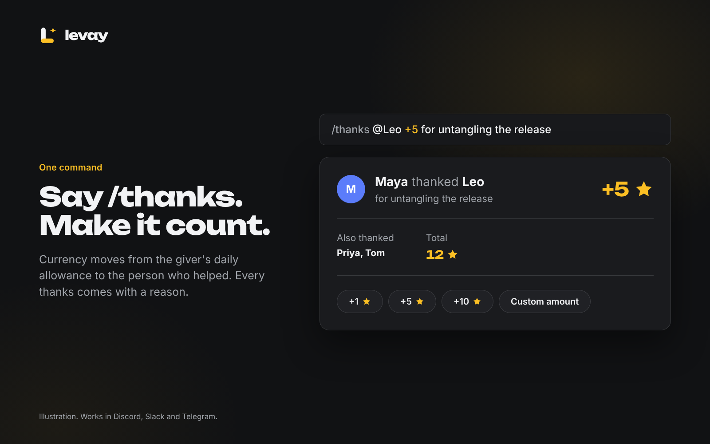

# Economy

### Economy/Currency - [UnbelievaBoat](https://unbelievaboat.com/)

With UnbelievaBoat you can set up a completely customizable economy system, completely free! The main premium 'feature' that MEE6 sells to you in this section is the ability to give and remove money to/from users however you like as a server administrator, and guess what; this ultra-simple function is 100% free with UnbelievaBoat. There are so many different ways to get money, and you can even customize the different messages that the bot sends when you've completed or failed a job! Along with 7 recognizable games that help you earn money, this currency system is easy to understand and so configurable you won't be able to tell it apart from the next one!\
_Price: $0_

.png>)

### Economy/Thanks - [Levay](https://levay.xyz/discord)

Levay is an economy built on members thanking each other. A member runs `/thanks @member reason amount`, and the amount moves from their own daily allowance to the member who helped. The giver gets nothing back, so the currency cannot be farmed. Members spend what they received in a server shop on roles, codes and other items the admin adds. Admins can add or remove currency for any member from the web dashboard, and every change is recorded. Profile cards, levels and a weekly leaderboard post are included. There are no games or work commands: currency only comes from other members.\
_Price: $0 during early access_

